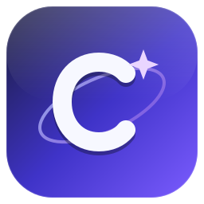

<div align="center">



# Cosmic Font Foundry

**A lightweight, local-first, open-source font manager and modular foundry for Windows 10 and 11.**
No subscriptions, no accounts, no telemetry, and zero bundled ML bloat (`~9.2 MB` native binary).

*Originally forked from [`atunfrito/tuna-fonts`](https://github.com/atunfrito/tuna-fonts) (MIT).*

</div>

## How Storage & Activation Work

Cosmic Font Foundry separates your **font archive** from **permanently installed Windows fonts** so your font menus in Word, Illustrator, and Photoshop stay fast and clutter-free:

| Location | What It Is | How Other Apps (Word, Illustrator, Notepad) See It |
| :--- | :--- | :--- |
| **System Fonts** (`C:\Windows\Fonts`) | Auto-discovered OS & Office fonts (essential UI fonts are locked). | Always available to all users. |
| **User Fonts** (`%LOCALAPPDATA%\Microsoft\Windows\Fonts`) | Fonts permanently installed for your Windows account (including **Drag & Drop** or **Install to Windows**). | Always available, even when Cosmic Font Foundry is closed or after reboot. |
| **Watched Folders** (Sidebar → `FOLDERS` → `+`) | A live index pointing to folders anywhere on your PC. **Nothing is copied or moved.** | Available in all apps while Cosmic Font Foundry is running (session-loaded via `AddFontResourceW`) when toggled **Active**. |
| **Central Font Vault** (`%USERPROFILE%\Cosmic Font Foundry\Vault`) | Physical, SHA-256-deduplicated copies organized by `<Vault>\<FamilyName>\`. Configurable in **Settings → Sync & Export**. | Automatically watched for **on-demand activation** in any app; click **Install to Windows** on any font's Specimen page to make it permanent. |

### Using Fonts in Word, Illustrator, or Notepad
You **never** need to browse the Vault folder from inside Word or Illustrator:
1. Open **Cosmic Font Foundry** and toggle a Vault font (or **Activate all** in a Collection) **On**.
2. Windows immediately loads it into the live system font table—the font appears in Word, Notepad, Illustrator, and Photoshop right away.
3. Toggle it **Off** when you're finished, or click **Install to Windows** on its Specimen page if you want it permanently available even when Cosmic Font Foundry is closed.

### Importing & Cleaning Up Scattered Fonts
- **Drag & Drop:** Dragging `.ttf`, `.otf`, `.ttc`, or `.otc` files onto the app window copies and installs them directly into Windows (`User` or `All Users` per Settings).
- **Consolidating into the Vault:** In **Settings → Sync & Export → Central Font Vault & Storage**, click **Import folder (copy)** to scan any messy folder or drive, copy unique fonts into your Vault (skipping exact SHA-256 duplicates), and leave your original files untouched. Once verified in the Vault, you can safely delete loose duplicate downloads from `Downloads`/`Desktop` (never delete files from `C:\Windows\Fonts`, `C:\Program Files`, or active project folders).

---

## Features

- **Instant Inventory & Menu Decluttering:** View every system, user, Vault, and watched-folder font grouped by family in list or grid view. Filter by **Installed only**, **Commercial-safe**, **Active / Inactive / Variable**, and sort by **Popular / Newest / A–Z**.
- **License & Commercial-Use Auditor:** Automatically classifies embedded OpenType license metadata (`Commercial-Safe`, `Personal Use Only`, `Commercial / Proprietary`, `Unverified`) with color-coded icons next to every font name and generates `FONTS-NOTICE.txt` inside exported bundles.
- **Offline PANOSE "Find Similar" & Smart Pairings:** Ranks visually similar fonts across your library using PANOSE proportions, category, scripts, and variable axes, and suggests complementary `Heading + Body` pairings.
- **One-Click Web & Design Kit Export:** In **Compare**, configure a modular **Type Scale** (`1.200`–`1.618`) and export a ready-to-drop `.zip` containing font files, `@font-face` `fonts.css` with CSS variables, `tailwind-typography.css` (`@theme`), and `FONTS-NOTICE.txt`.
- **Tranquil Nebula UI & Editorial Specimen:** Warm obsidian dark mode and alabaster light mode, formatting sampler (`B / I / U / S / AA`), Light/Dark specimen surface toggle, 2-column Editorial Article Preview, Waterfall, and character map.
- **Multi-Foundry Discover & Custom Feed Subscriptions:** Browse **Google Fonts**, **Fontshare**, **Fontsource Open Foundry**, **Adobe & Dev Originals**, and **Font Squirrel** (with **All / Installed / Uninstalled** filters), or subscribe to **RSS / Atom XML, JSON Catalogs, and GitHub Releases**.
- **Forge Studio (Modular Font Creator):** Design custom fonts on a `7×9` or `14×18` grid with `A–Z`, `a–z`, `ÁÉÑ`, `0–9`, and symbol glyphs, parametric DNA sliders, live `.ttf` binary compilation, export, and one-click Windows installation.
- **Variable Font Playground & OpenType Inspector:** Live sliders for `wght`, `wdth`, `opsz`, `slnt`, and custom `fvar` axes; toggle `liga`, `dlig`, `smcp`, `onum`, `tnum`, `ss01`–`ss20`; inspect scripts and SHA-256 duplicates/conflicts.
- **Global Quick-Switcher (`Ctrl+Shift+F`), Project Auto-Detection & BYO-Sync:** Detect `.cosmicfonts.json` and Adobe `Document fonts/` folders, sync collections via any cloud/Syncthing folder (`cosmic-manifest.json`), or export client `.zip` bundles.
- **Optional Local MCP & Agent Control (Hidden in Settings):** Reveal **Agent Hub** in Settings for a localhost-only (`127.0.0.1:17420`) MCP JSON-RPC 2.0 + REST control plane, read-only monitoring mode, deterministic command director, or BYO-AI (Ollama / OpenAI-compatible).

## Privacy & System Safety

- Everything runs locally on your machine. Network traffic only occurs when browsing Discover, syncing custom font feeds, or checking GitHub releases.
- Essential Windows system fonts (`Segoe UI`, `Arial`, `Consolas`, etc.) remain permanently locked; system fonts require explicit user unlock and UAC elevation, with backups stored prior to modification.
- User font installs use exclusive file creation (`create_new`) and SHA-256 verification before deactivation so externally modified or foreign fonts are never overwritten or removed.
- Custom feed URLs enforce `is_public_url` SSRF checks against loopback and private network addresses.

## Build From Source

Requires [Node.js 22+](https://nodejs.org), [Rust](https://rustup.rs) stable, and the Windows WebView2 runtime.

```bash
git clone https://github.com/theCosmicCrafter/cosmic-font-foundry.git
cd cosmic-font-foundry
npm ci
npm run installer
```

Run checks & tests:

```bash
cargo fmt --manifest-path src-tauri/core/Cargo.toml -- --check
cargo fmt --manifest-path src-tauri/Cargo.toml -- --check
cargo clippy --manifest-path src-tauri/core/Cargo.toml --all-targets -- -D warnings
cargo clippy --manifest-path src-tauri/Cargo.toml --all-targets -- -D warnings
cargo test --manifest-path src-tauri/core/Cargo.toml
cargo test --manifest-path src-tauri/Cargo.toml --locked
```

## Contributing & Community

- [Contributing Guide](CONTRIBUTING.md)
- [Code of Conduct](CODE_OF_CONDUCT.md)
- [Security Policy](SECURITY.md)
- [Project Governance](GOVERNANCE.md) & [Maintainers](MAINTAINERS.md)
- [Changelog](CHANGELOG.md)

## License

[MIT](LICENSE). SPDX-compliant via [`REUSE.toml`](REUSE.toml). See [THIRD-PARTY-NOTICES.md](THIRD-PARTY-NOTICES.md) for bundled font and library notices.
