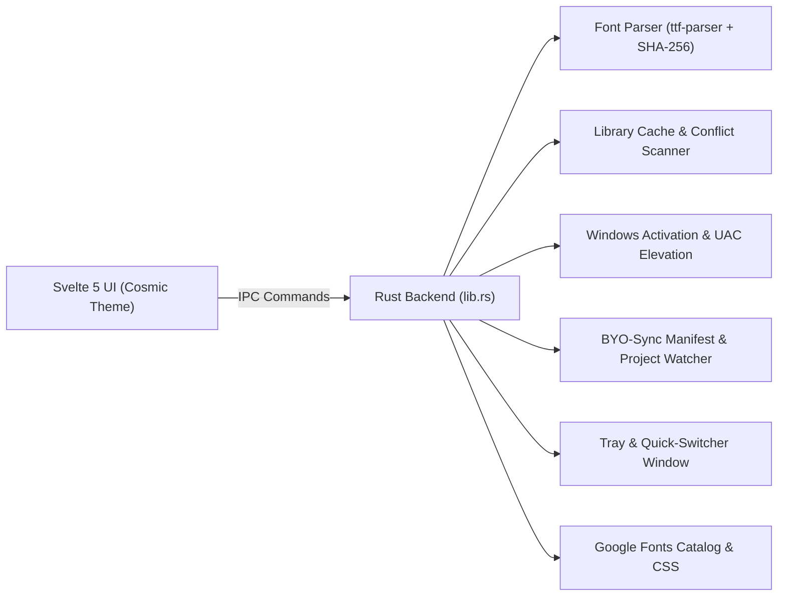

# Implementation Plan: Cosmic Font Foundry (Windows v1)

## Goal Description
Transform [`theCosmicCrafter/tuna-fonts`](https://github.com/theCosmicCrafter/tuna-fonts) (`v0.2.3`, MIT) into **Cosmic Font Foundry**, a Windows-first, open-source font manager built on **Tauri 2 (Rust) + Svelte 5**.

This v1 plan covers:
1. **Full Rebrand & English Codebase Refactor:** Rebrand product name, bundle identifier (`com.thecosmiccrafter.cosmicfontfoundry`), Cosmic dark/light visual palette, icons, updater endpoints, and NSIS installer; translate all Spanish filenames, Rust modules/structs/commands, Svelte components, and comments to clean English for external contributors.
2. **Isolated Data + Optional Migration:** Use `%APPDATA%\com.thecosmiccrafter.cosmicfontfoundry` with a one-click *Import from tuna-fonts* wizard in Settings.
3. **Full Studio v1 Upgrades:**
   - Variable font axis detection & live sliders (`fvar`: `wght`, `wdth`, `opsz`, `slnt`, custom axes) + CSS export.
   - OpenType feature inspection & toggles (`liga`, `dlig`, `smcp`, `onum`, `tnum`, `ss01`–`ss20`).
   - Script/language coverage badges (`Latin Ext`, `Cyrillic`, `Greek`, `Arabic`, `CJK`, `Vietnamese`) & license/foundry metadata extraction (`name` IDs `8`, `9`, `13`, `14`).
   - Full Specimen/Inspector modal inside Google Fonts **Discover** before installing.
   - Side-by-side & Heading/Body pairing modes in **Compare**.
   - Duplicate/family-collision & corrupt-font scanner with safe quarantine.
   - Global hotkey (`Ctrl+Shift+F`) **Quick-Switcher** overlay + enhanced tray collection toggles.
   - Industry-standard **BYO-Sync Manifest** (portable `cosmic-manifest.json` matching fonts by SHA-256 content hash + PostScript/family name) + project-folder `.cosmicfonts.json` auto-activation & client ZIP packager.

---

## Proposed Architecture & Modules

### 1. Rebrand, Licensing & Build Pipeline
- **`LICENSE`, `THIRD-PARTY-NOTICES.md`, `README.md`:** Preserves original MIT attribution to `atunfrito/tuna-fonts` alongside Cosmic Font Foundry copyright and documentation.
- **`package.json`, `src-tauri/Cargo.toml`, `src-tauri/tauri.conf.json`, `src-tauri/tauri.release.conf.json`:** Updated product metadata, icons, capabilities, and NSIS hooks.
- **`.github/workflows/{ci.yml,release.yml,winget.yml}` & `winget/`:** CI validation for `cosmic-core` + Vite + Windows Tauri builds, portable ZIP/NSIS release packaging, and `TheCosmicCrafter.CosmicFontFoundry` winget templates.

### 2. Platform-Independent Core (`src-tauri/core`)
- `reader.rs`: Extracts `fvar` variable axes, `GSUB` OpenType tags, `OS/2` script coverage, foundry/designer/license `name` IDs, and SHA-256 hashes.
- `inventory.rs` & `cache.rs`: Parallel caching (`Cache::VERSION = 3`), SHA-256 duplicate detection, style collision checks, and corrupt file surfacing.
- `sync.rs`: `cosmic-manifest.json` BYO-Sync engine, `.cosmicfonts.json` project-folder manifest detection, portable JSON import/export, and pure-Rust PKZIP export with generated `LICENSES.txt`.
- `migrate.rs`: Non-destructive one-click migrator from `%APPDATA%\es.atunfrito.tunafonts`.

### 3. Windows Backend (`src-tauri/src`) & Tray
- Refactored English modules (`lib.rs`, `win.rs`, `tray.rs`, `startup.rs`, `google.rs`, `fonts/`).
- Native Win32 global hotkey (`RegisterHotKey`, default `Ctrl+Shift+F`) for the Spotlight-style Quick-Switcher (`quick` window) and pinned collection toggles in the tray popup.

### 4. Svelte 5 UI (`src/`)
- Cosmic Indigo / Deep Slate daylight & dark themes (`src/app.css`).
- Upgraded `Specimen.svelte` (local + Google Discover preview, live axes, OpenType toggles, Copy CSS, tags, credits, quarantine), `Compare.svelte` (Stacked, Columns, Heading + Body pairing), `Settings.svelte` (Sync & Export, migration, global shortcut), `Menu.svelte`, and `QuickSwitcher.svelte`.
